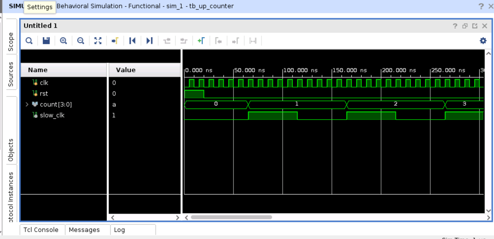
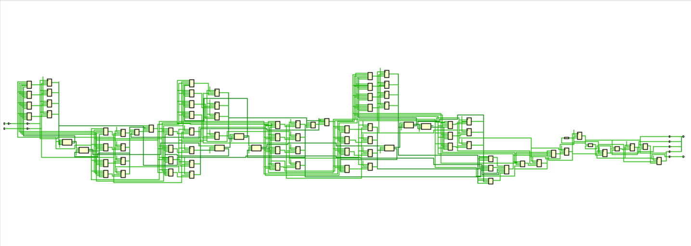
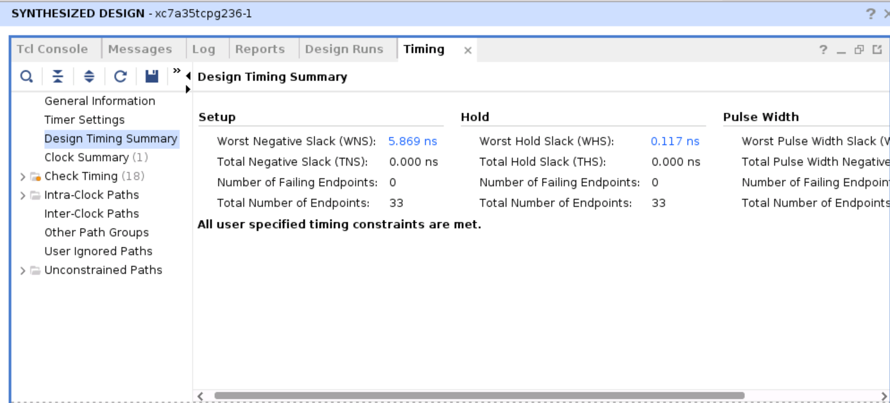
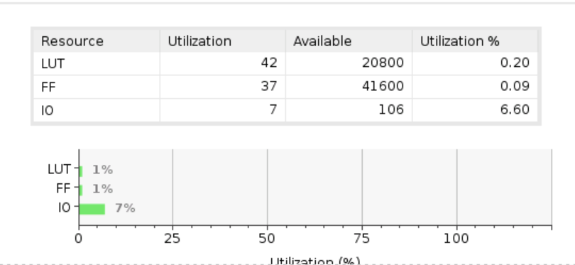
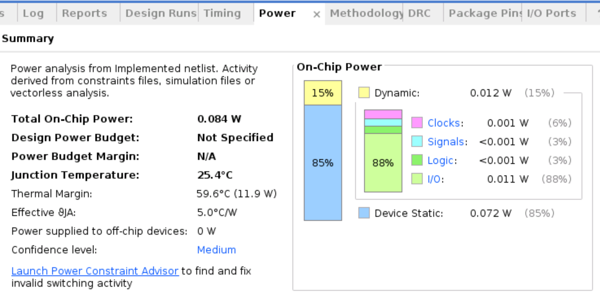
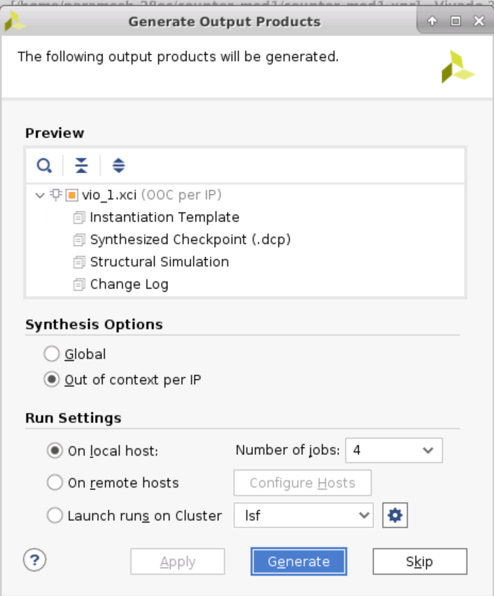
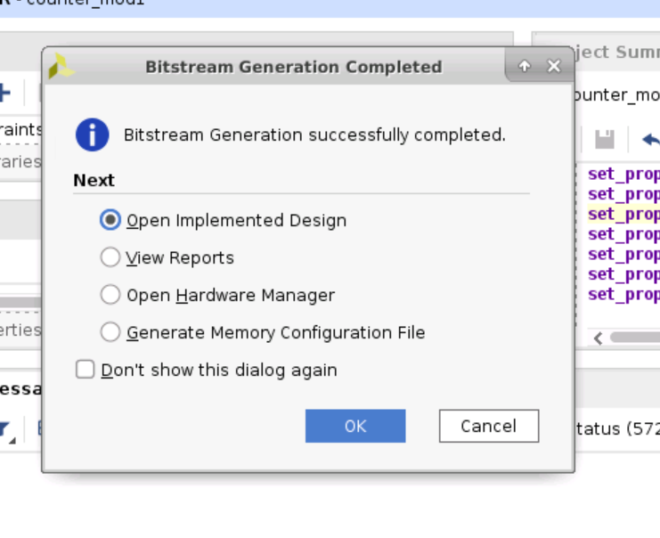

# Module 1 – FPGA Implementation Using Vivado

## 1. Overview

This module explores the FPGA design implementation workflow using AMD/Xilinx Vivado. The practical work covers RTL design visualization, simulation, timing analysis, resource utilization, power analysis, Virtual Input/Output (VIO) IP generation, and bitstream generation.

## 2. Objectives

- Understand the RTL design representation of a digital circuit.
- Analyze the functional behavior of the design through waveform simulation.
- Examine timing characteristics using the timing report.
- Analyze FPGA resource utilization.
- Explore power analysis in Vivado.
- Understand the generation of VIO IP for interactive FPGA debugging.
- Generate a bitstream for the selected FPGA device.

## 3. Tools Used

- AMD/Xilinx Vivado Design Suite
- Verilog HDL
- Vivado Simulator
- Vivado IP Catalog

## 4. Design Description

**Design:** 4-bit up-counter with a clock divider.

The design uses a clock-divider stage to generate a slower clock and a counter stage to increment a 4-bit count. The implementation is analyzed using Vivado's simulation and implementation tools.

## 5. Implementation and Analysis

### 5.1 Waveform Simulation

The behavioral simulation waveform is used to observe the circuit's response to the applied input stimulus. It helps verify the clock-divider behavior, counter progression, and reset operation where applicable.

### 5.2 RTL Schematic

The RTL schematic illustrates the logical structure inferred from the Verilog design. It provides a visual representation of the design hierarchy, signals, and connections between the circuit components.

### 5.3 Timing Analysis

The timing report is used to evaluate the timing characteristics of the implemented design. Parameters such as worst negative slack (WNS), total negative slack (TNS), and other reported timing values help determine whether the design meets its specified timing constraints.

### 5.4 Resource Utilization

The utilization summary reports the FPGA resources used by the design, including lookup tables (LUTs), flip-flops, input/output resources, and other available resource categories reported by Vivado.

The actual resource counts should be interpreted from the accompanying report.

### 5.5 Power Analysis

Vivado power analysis estimates the power consumption of the design under the selected analysis conditions. The report may include static power, dynamic power, and total estimated on-chip power.

The estimates depend on the target device, design activity, clock conditions, and available switching-activity information.

### 5.6 VIO IP Generation

The Virtual Input/Output (VIO) IP allows internal FPGA signals to be monitored and, when configured as virtual inputs, controlled interactively during hardware debugging. This section documents the VIO IP generation workflow in Vivado.

Generating the VIO IP alone does not demonstrate successful live hardware debugging; that requires implementation, bitstream generation, and a compatible FPGA board.

### 5.7 Bitstream Generation

Bitstream generation produces the configuration file used to program a compatible FPGA device. The screenshot records the successful completion of this stage in Vivado.

## 6. Results and Observations

The practical work demonstrates the use of Vivado for examining the RTL design, simulating circuit behavior, analyzing timing and resource utilization, estimating power, generating VIO IP, and producing an FPGA bitstream.

Detailed numerical results should be taken from the corresponding reports and screenshots.

## 7. Conclusion

The practical provided experience with the Vivado FPGA implementation workflow, including simulation, design visualization, timing and resource analysis, power estimation, IP generation, and bitstream creation. These steps form the foundation for implementing and debugging digital designs on FPGA hardware.

## 8. Hardware Verification

Successful bitstream generation does not by itself verify the circuit on a physical FPGA. Hardware programming and live VIO debugging should be documented separately if performed.
